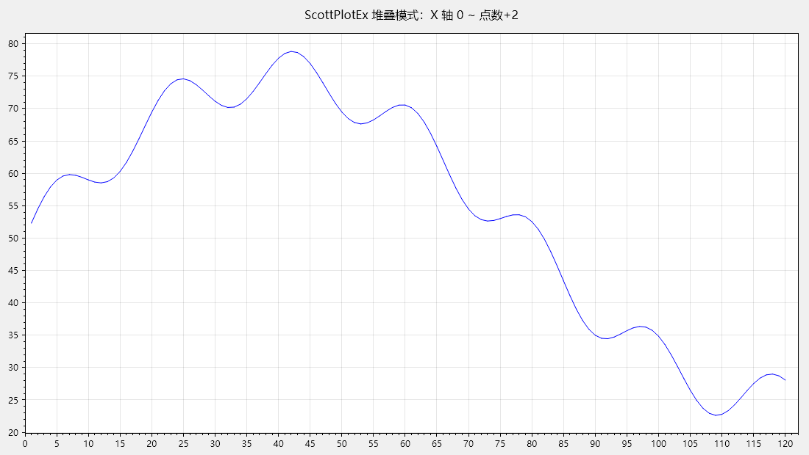
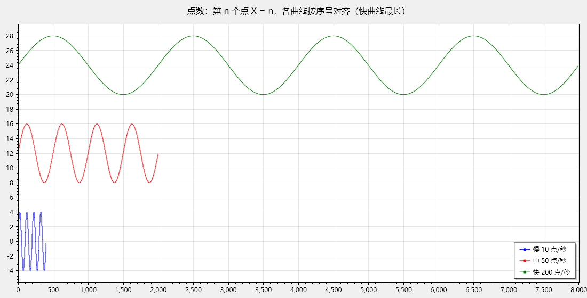
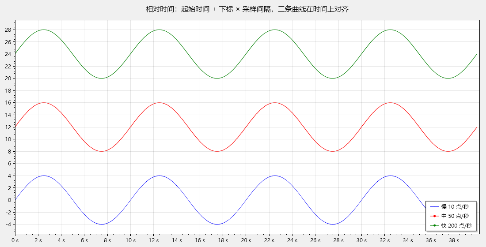
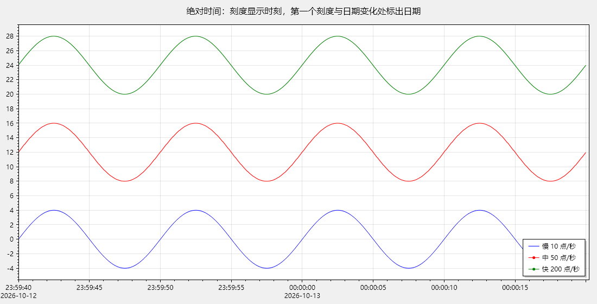

# ScottPlotEx — 嵌入 ScottPlot 的 WinForms 实时曲线控件

一个可直接使用的 **Windows Forms 用户自定义控件**：控件内部用 ScottPlot 5 绘图，画面由自绘画布呈现
（SkiaSharp 直接渲染进 GDI DIB，`WM_PAINT` 中一次 `BitBlt` 到窗口），
完整实现 `ScottPlot.IPlotControl` 全部接口，并在其之上提供“**堆叠 / 跟随 / 手动**”三种坐标轴滚动模式、
“**点数 / 相对时间 / 绝对时间**”三种 X 轴单位（对标 imc 曲线窗口，每条曲线可以有自己的采样间隔）与中文右键菜单。



## 目录结构

```
ScottPlotEx.sln
├─ src/ScottPlotEx.Controls   用户控件库（核心交付物）
├─ src/ScottPlotEx.Demo       演示程序：每秒添加 1 个数据点、可切换模式；另有“多曲线测试”“10 曲线流式演示”“堆叠堆积压测”窗口
├─ tests/ScottPlotEx.Tests    自动化测试（227 个用例，含真实窗体与真实窗口消息的鼠标操作验证、多曲线、X 轴单位；另有性能基准与闪烁量化）
├─ artifacts/                 测试生成的示例图片
├─ docs/                      真实演示程序运行截图
├─ LICENSE                    本项目许可（MIT）
└─ THIRD-PARTY-NOTICES.md     第三方软件的许可与版权声明
```

## 快速开始

```powershell
dotnet build ScottPlotEx.sln          # 生成解决方案
dotnet test  ScottPlotEx.sln --filter "Category!=Performance"   # 运行全部功能测试（227 个）
dotnet test  ScottPlotEx.sln --filter "Category=Performance"   # 只跑性能基准
dotnet run --project src\ScottPlotEx.Demo   # 运行演示程序
dotnet run --project src\ScottPlotEx.Demo -- --multiseries   # 直接打开“多曲线测试”窗口（--preset 0/1/2 选择预设场景，--unit 0/1/2 选择 X 轴单位；--unit 2 绝对时间会自动把起始时间设为当前时间）
```

演示程序主窗口上的 **“多曲线测试”** 按钮打开多曲线功能的交互测试窗口：

- 曲线列表（勾选 = 显示）：添加 / 删除 / 清空 / 开始 / 停止所选曲线，列表实时显示每条曲线的点数与最新值；
- 每条曲线独立的数据源：波形（正弦 / 方波 / 锯齿 / 随机游走 / 噪声）、幅值、偏移、速率、线宽、颜色，
  写入方式可选 **UI 定时器**（UI 线程同步写入）或 **后台线程**（跨线程按帧合并）；勾选“清空 / 删除从后台线程发起”可验证跨线程的顺序保证；
- 控件选项：堆叠 / 跟随 / 手动、**X 轴单位（点数 / 相对时间 / 绝对时间，运行中可切换）**、显示百分比、
  跟随固定窗口（按当前单位：点数单位填点数 = `FollowWindowPoints`，时间单位填秒数 = `FollowWindowDuration`）、帧率上限、图例、全部开始 / 停止 / 清空；
- **起始时间**（日期时间选择框 + “使用当前时间”，即控件的 `DefaultStartTime`）：不勾选时相对时间按每条曲线第一个点到达的时刻；
  **绝对时间必须先设置起始时间**——未设置时下拉框里的“绝对时间”灰显并注明“需先设置起始时间”，选择它会被拒绝并在状态栏说明原因；
  处于绝对时间时不能取消起始时间。已设置起始时间时，应用预设 / 全部清空会把它更新为当前时间（重新开始一次测量）；
- 每条曲线的采样间隔由它的“点/秒”决定（`PlotSeries.SampleRate`）：时间单位下各曲线按“起始时间 + 下标 × 采样间隔”在时间上对齐；
- 预设场景：**量级差别大**（温度约 25 / 压力约 3000 / 振动 ±0.5，可以直观看到共用 Y 轴时小量级曲线被压平）、
  **长短不一**（10 / 50 / 200 点/秒：点数单位下 X 轴取最长的可见曲线，隐藏最长的一条 X 轴随之变短；
  切到相对 / 绝对时间后三条曲线的最新数据在时间上对齐）、**10 条 × 1000 点/秒**（后台线程压测，跟随窗口 60000 点 / 60 秒）；
  预设不改变当前选择的 X 轴单位；
- 状态栏：写入速率、绘制帧率、内存中点数、当前坐标轴范围（按单位显示为序号 / 秒 / 时刻）。

| 点数（第 n 个点 X = n） | 相对时间 | 绝对时间 |
|---|---|---|
|  |  |  |

（同样 40 秒的数据：10 / 50 / 200 点/秒的三条曲线在点数单位下长短不一，在时间单位下对齐；绝对时间跨过午夜时标出新日期。图片由 `XAxisUnitTests.RenderArtifacts` 生成。）


在自己的项目中使用：

```xml
<ProjectReference Include="..\ScottPlotEx.Controls\ScottPlotEx.Controls.csproj" />
```

```csharp
// 1) 把控件放到窗体上（设计器工具箱中名为 ScrollingPlotControl）
var plot = new ScrollingPlotControl { Dock = DockStyle.Fill };
Controls.Add(plot);

// 2) 每秒添加一个数据点（默认堆叠模式，X 轴自动从 0 增长到 点数+2）
var timer = new System.Windows.Forms.Timer { Interval = 1000 };
timer.Tick += (s, e) => plot.AddValue(ReadSensorValue());
timer.Start();

// 3) 也可以切换到跟随模式（X 轴只显示最新 30% 数据，最大值同样为 点数+2）
plot.Mode = ScrollingMode.Follow;
```

多条曲线（对应 imc 曲线窗口的多通道）：每条曲线一个 `PlotSeries`，采集线程可以直接写入，控件负责跨线程合并与坐标轴：

```csharp
var plot = new ScrollingPlotControl { Dock = DockStyle.Fill, ShowLegend = true };
PlotSeries temperature = plot.AddSeries("温度");
PlotSeries pressure    = plot.AddSeries("压力", ScottPlot.Colors.Red);

// 任意线程：单点或批量写入（非 UI 线程的写入按帧合并成一条窗口消息）
temperature.AddValue(23.5);
pressure.AddValues(samples.AsSpan(0, count));   // 返回后即可复用 samples

// 示波器式滚动：跟随模式只显示最近 60 秒（每秒 1000 点），重绘最多 30 帧/秒
plot.Mode = ScrollingMode.Follow;
plot.FollowWindowPoints = 60_000;
plot.MaxFramesPerSecond = 30;

pressure.IsVisible = false;   // 隐藏的曲线不绘制、也不参与坐标轴计算
pressure.Remove();            // 删除曲线
```

X 轴单位（对标 imc 曲线窗口的“Samples / Days/hours/minutes: Relative / Date/time: Absolute”）：
每条曲线可以有自己的采样间隔，时间单位下各曲线按“起始时间 + 下标 × 采样间隔”在时间上对齐：

```csharp
temperature.SampleRate = 10;                              // 10 点/秒（也可以写 SampleInterval = TimeSpan.FromMilliseconds(100)）
pressure.SampleRate    = 1000;                            // 每条曲线自己的采样间隔；未设置时取 plot.DefaultSampleInterval（默认 1 秒）
DateTime measurementStart = DateTime.Now;
plot.DefaultStartTime  = measurementStart;                // 起始时间：相对时间可选（不设则取每条曲线第一个数据点写入控件的时刻），绝对时间必须设置
PlotSeries vibration   = plot.AddSeries("振动", startTime: measurementStart.AddSeconds(5)); // 也可以按曲线指定（这一路晚 5 秒开始）

plot.XAxisUnit = XAxisUnit.RelativeTime;                  // X = 距 TimeReference 的秒数，刻度自动显示为 秒 / 分:秒 / 时:分:秒 / 天
plot.Mode = ScrollingMode.Follow;
plot.FollowWindowDuration = TimeSpan.FromSeconds(60);     // 时间单位下的跟随窗口：显示最近 60 秒

plot.XAxisUnit = XAxisUnit.AbsoluteTime;                  // 运行中切换：数据保留、立即重算，刻度显示日期时间（没有起始时间时抛 InvalidOperationException）
DateTime time = plot.TimeReference!.Value.AddSeconds(x);  // 任意 X 对应的时刻（例如游标读数）
```

## 需求实现对照

| # | 需求 | 实现 | 验证 |
|---|------|------|------|
| 1 | 每秒添加数据时默认堆叠模式：X 轴 0 ~ 当前数据点数量 + 2，Y 轴为数据最大值/最小值各向外 5% | `ScrollingAxisCalculator` + `ScrollingPlotControl.ApplyAutoScroll()`，默认 `Mode = Stacked` | `ScrollingPlotControlTests.StackedMode_IsDefaultAndFitsRequirements`、`ScrollingAxisCalculatorTests`、`docs/demo-01-stacked.png` |
| 2 | 可选跟随模式：X 轴为最新 30% 数据且最大值同为 当前数据点数量 + 2，Y 轴为当前显示数据最大值/最小值各向外 5% | `ScrollingMode.Follow`，Y 轴按可见 X 范围统计（`PlotDataBuffer.TryGetValueRange(xMin, xMax, …)`） | `ScrollingPlotControlTests.FollowMode_UsesTrailingDataAndVisibleYRange`、`ScrollingAxisCalculatorTests.FollowMode_*`、`artifacts/follow-mode.png` |
| 3 | 放大局部数据后曲线停止滚动，直到重新选择堆叠/跟随模式 | 滚轮缩放、右键拖动缩放 → `AutoScrollPolicy` 返回 `StopScrolling` → `Mode = Manual`；重新设置 `Mode` 立即恢复 | `AutoScrollPolicyTests`、`MouseInteractionTests.WheelZoom_StopsScrolling` / `RightDragZoom_StopsScrolling` / `AfterStopping_SelectingModeAgain_ResumesScrolling` |
| 4 | 右键弹出 ScottPlot 自带菜单（中文）+“显示帮助” | `ChinesePlotMenu`：与 `FormsPlotMenu.StandardContextMenuItems()` 一一对应（保存图像 / 复制到剪贴板 / 自动缩放 / 在新窗口中打开，按其实现重写），文字为中文并追加“显示帮助” | `ChinesePlotMenuTests`、`MouseInteractionTests.RightClick_ShowsChineseContextMenu`、`docs/demo-04-context-menu.png` |
| 补充 3 | 把堆叠 / 跟随模式放进右键菜单，并作为**勾选项** | `ChinesePlotMenu` 把“堆叠模式 / 跟随模式 / 手动模式”渲染为 `Checked` 勾选项：勾选状态由当前模式推导（`CheckOnClick = false`，点击不会自行切换勾选），菜单打开期间模式变化会用 `SyncModeChecks` 实时同步 | `ChinesePlotMenuTests.ModeItems_*`、`docs/demo-04-context-menu.png` |
| 5 | 鼠标操作完全没有障碍 | 不拦截、不改写 ScottPlot 的输入响应链，仅在事件之后观察视图变化；只用 `LostFocusAction` 把“焦点丢失时的同步整帧重绘”换成合并重绘（终止拖动的语义保持不变） | `ScrollingPlotControlTests.UserInputProcessor_KeepsScottPlotDefaults`、`MouseInteractionTests`（各类操作）、`InteractionSmoothnessTests` |
| 6 | 左键拖动后：能看到最新数据则保持堆叠模式且 X 轴最小值取当前最小值；否则停止滚动 | `OnPlotMouseUp` 判定手势 → `AutoScrollPolicy` → `XOffset = 当前 X 轴最小值 − 自动窗口最小值` 或 `Mode = Manual` | `MouseInteractionTests.LeftDrag_WithLatestDataVisible_KeepsStackedMode` / `LeftDrag_WithoutLatestData_StopsScrolling`、`docs/demo-02-after-drag.png` |
| 7 | 中键放大后逻辑与左键拖动相同 | 中键框选放大识别为 `MiddleDragZoomRectangle`，与 `LeftDragPan` 走同一策略分支 | `AutoScrollPolicyTests`、`MouseInteractionTests.MiddleDragZoom_*` |
| 补充 1 | 鼠标中键单击（整体显示）后取消“停止滚动”，恢复原来的模式 | `AutoScrollPolicy` 在手动模式下遇到 `Autoscale` 手势返回 `ResumePreviousMode`，控件用 `LastAutoScrollMode` 恢复停止前的模式 | `AutoScrollPolicyTests.ManualMode_WithAutoscale_ResumesPreviousMode`、`MouseInteractionTests.MiddleClickAutoscale_AfterDragStopped_ResumesStackedMode` |
| 补充 2 | 跟随模式下按鼠标中键，自动换成堆叠模式 | `AutoScrollPolicy.ResolveAutoscaleMode`：整体显示时跟随模式解析为堆叠模式（`SwitchToStackedOnAutoscale`，默认开启） | `AutoScrollPolicyTests.ResolveAutoscaleMode_*`、`MouseInteractionTests.MiddleClickAutoscale_InFollowMode_SwitchesToStackedMode`、`DemoScreenshotTests`、`docs/demo-06-follow-mode.png` → `docs/demo-07-follow-to-stacked.png` |
| 补充 4 | 鼠标一操作就出现的那次卡顿要去掉 | ① **鼠标手势期间暂停自动滚动**：按住鼠标并拖动（左键平移 / 中键框选 / 右键缩放）时，新数据只进缓冲区、不再移动坐标轴，避免每个数据点都把视图拉回自动窗口（实测一次回跳 500+ 个数据点）并覆盖用户的拖动结果；② **画布失去焦点时不再同步整帧重绘**，改为合并重绘（仍保留“焦点丢失即终止拖动”的 ScottPlot 语义），去掉鼠标刚点下瞬间的一次整帧重绘 | `AutoScrollDuringGestureTests`、`InteractionSmoothnessTests` |
| 补充 5 | 两种模式都要能设置 X 轴显示长度（百分比接口） | `SetXAxisDisplayPercent(percent, mode)`（写入必须指定模式）+ 只读的 `CurrentXAxisDisplayPercent`/`GetXAxisDisplayPercent(mode)` + `ShowAllData()`；底层为 `StackedDisplayPercent`（默认 100 = 全部数据）与 `FollowWindowPercent`（默认 30，尾部窗口）。**方向一致：数值越大看得越多**，越界自动限制，改动后立即重算坐标轴且不切换模式 | `XAxisDisplayPercentTests`、`ReproFollowToStackedTests.StackedMode_DisplayPercent90_StillLooksStacked`、`ScrollingAxisCalculatorTests.StackedMode_DisplayPercent*` / `FollowMode_WindowPercent*` |
| 补充 6 | 调整百分比后必须能改回堆叠模式 | **重新选择模式即恢复该模式默认视图**：选择“堆叠模式”把原点百分比复位为 0%（`X: [0, 点数+2]`），选择“跟随模式”把窗口复位为 30%；数据更新、拖动、中键整体显示都不会复位。可用 `AxisOptions.ResetDisplayPercentOnModeChange = false` 改为“百分比跨模式保持” | `ReproFollowToStackedTests.AfterChangingStackedPercent_ReselectingStackedShowsAllData` / `AfterChangingFollowPercent_ReselectingFollowRestoresDefaultWindow` / `DisplayPercent_CanPersistAcrossModeChanges`、`docs/demo-08-stacked-after-percent.png` |
| 补充 7 | X 轴单位对标 imc：点数 / 相对时间 / 绝对时间；每条曲线可以有自己的采样间隔；跟随窗口同样支持三种单位；时间单位下平滑滚动；绝对时间必须设置起始时间 | `XAxisUnit`、`PlotSeries.SampleInterval / SampleRate / StartTime`、`DefaultSampleInterval / DefaultStartTime`、`FollowWindowDuration`；所有按 X 计算的地方按曲线做“下标 ↔ X”换算（`SeriesXExtent`、`PlotDataBuffer.XStart / XStep`、数据源 `Period / XOffset`）；`TimeAxisTickGenerator` 生成时间刻度 | `XAxisUnitTests`、`XAxisUnitDemoTests`、`artifacts/x-axis-*.png` |
| 8 | 完整验证，特别是各类鼠标操作，不能闪退 | 227 个自动化测试（含真实窗体+消息循环+Skia 绘制+真实 Windows 鼠标消息）＋真实演示程序消息级操作验证 | `dotnet test`，见下文“验证结果” |

## 控件 API

### 滚动模式与数据

| 成员 | 说明 |
|------|------|
| `Mode`（`ScrollingMode`） | `Stacked`（默认）/ `Follow` / `Manual`。重新赋值即复位偏移并立即恢复滚动 |
| `AddValue(double y)` | 向**默认曲线**追加一个数据点，X 自动递增（点数单位第 n 个点 X = n；时间单位见 `XAxisUnit`）。**可在任意线程调用** |
| `AddValues(IEnumerable<double>)` / `AddValues(params double[])` / `AddValues(ReadOnlySpan<double>)` | 向默认曲线批量追加 |
| `ClearData()` | 清空**全部曲线**的数据（曲线本身保留）并回到空视图 |
| `DataCount` / `LatestX` / `LatestValue` / `Values` / `SkippedValueCount` | 默认曲线的数据查询（NaN、Infinity 会被忽略并计入 `SkippedValueCount`） |
| `AddSeries(name, color?, startTime?)` → `PlotSeries` | 添加一条曲线（不指定颜色时按调色板取色；`startTime` 等同于创建后设置 `PlotSeries.StartTime`）。可在任意线程调用。绝对时间单位下既没有 `startTime` 也没有 `DefaultStartTime` 时抛出 `InvalidOperationException` |
| `Series` / `DefaultSeries` | 全部曲线的快照（默认曲线在第一位）/ 默认曲线（单曲线接口读写的曲线，始终存在、不能删除） |
| `ShowLegend` | 是否显示图例（列出名称不为空的曲线；默认曲线名称为空，不出现在图例里），默认 `false` |
| `FollowWindowPoints` | 跟随模式固定窗口宽度（数据点），默认 `0` = 按 `FollowWindowPercent`；大于 0 时始终显示最后这么多个点（示波器式滚动），重新选择跟随模式不会复位。点数单位使用；时间单位下若没有设置 `FollowWindowDuration`，按各曲线的采样间隔换算成时长（取最长的一条） |
| `FollowWindowDuration` | 跟随模式固定窗口时长（`TimeSpan`，相对时间 / 绝对时间单位下使用），默认 `0` = 不按时长；大于 0 时始终显示最近这么长时间，重新选择跟随模式不会复位 |
| `XAxisUnit`（`XAxisUnit`） | X 轴单位：`Samples`（点数，默认：第 n 个点 X = n，各曲线按序号对齐）/ `RelativeTime`（相对时间：X = 距 `TimeReference` 的秒数，刻度显示 秒 / 分:秒 / 时:分:秒 / 天）/ `AbsoluteTime`（绝对时间：X 同相对时间，刻度显示日期时间）。运行中切换时数据保留、立即重算坐标轴。切换到绝对时间时若有曲线没有明确设置的起始时间（还没有数据的默认曲线除外），抛出 `InvalidOperationException`（中文提示设置 `DefaultStartTime` 或各曲线的 `StartTime`），单位保持不变 |
| `DefaultSampleInterval` | 曲线默认的采样间隔（`TimeSpan`，默认 1 秒），没有设置 `PlotSeries.SampleInterval` 的曲线使用；只在时间单位下影响 X |
| `DefaultStartTime` | 曲线默认的起始时间（`DateTime?`，默认 `null` = 相对时间下每条曲线以自己第一个数据点写入控件的时刻为起始时间；绝对时间不使用该时刻）。绝对时间单位下若有曲线依赖它，设为 `null` 抛出 `InvalidOperationException`。设置后清空数据不会改变它 |
| `TimeReference` | 时间单位下 X = 0 对应的时刻（全部曲线生效起始时间中最早的一个，只读）；任意 X 的时刻 = `TimeReference + X 秒` |
| `MaxFramesPerSecond` | 跨线程写入触发的重绘帧率上限，默认 `0` = 不限。高精度定时器控制，30 就是 30 帧/秒（不受 WinForms 定时器约 15.6 ms 精度影响）；数据照常全部接收 |
| `IsScrollingStopped` / `XOffset` | 是否已停止滚动 / 当前 X 轴偏移量 |
| `LastAutoScrollMode` | 最近一次的自动滚动模式（堆叠或跟随），中键单击整体显示后恢复到该模式 |
| `SetXAxisDisplayPercent(percent, mode)` | 设置**指定模式**的 X 轴显示长度百分比（模式必填），立即生效；堆叠=按当前点数把原点**固定**在该百分比处（100=原点 0 显示全部），跟随=显示最后 `百分比` 的滑动窗口 |
| `CurrentXAxisDisplayPercent` / `GetXAxisDisplayPercent(mode)` | 读取当前模式 / 指定模式的百分比（只读，安全） |
| `StackedDisplayPercent` / `FollowWindowPercent` | 直接读写两种模式的百分比（默认 `100` / `30`），越界值自动限制在有效范围 |
| `ShowAllData()` | 恢复显示全部数据（把堆叠模式显示百分比设为 `100`） |
| `AxisOptions`（`ScrollingAxisOptions`） | 留白比例、窗口百分比、各类策略开关等可调参数 |
| `AxisOptions.StackedRightMarginPoints` | 堆叠模式 X 轴右侧固定留白（单位：数据点；时间单位下为可见曲线中最大的采样间隔），默认 `2` |
| `AxisOptions.FollowRightMarginPoints` | 跟随模式 X 轴右侧固定留白（单位：数据点；时间单位下为可见曲线中最大的采样间隔），默认 `2` |
| `AxisOptions.SwitchToStackedOnAutoscale` | 整体显示（中键单击 / 菜单自动缩放）时，跟随模式是否自动切换为堆叠模式，默认 `true` |
| `AxisOptions.PauseAutoScrollDuringGesture` | 鼠标拖动 / 框选 / 缩放过程中是否暂停自动滚动（新数据不移动坐标轴），默认 `true`，用于避免“鼠标一操作就卡一下” |
| `AxisOptions.ResetDisplayPercentOnModeChange` | 重新选择模式时是否把该模式的 X 轴显示百分比恢复默认（堆叠 0% / 跟随 30%），默认 `true` |
| `ShowModeMenuItems` | 是否在右键菜单中显示“堆叠 / 跟随 / 手动”**勾选项**，默认 `true` |
| `PlotMenu.SyncModeChecks(ContextMenuStrip)` | 把菜单中的模式勾选状态同步为当前模式（模式在菜单打开期间变化时自动调用） |
| `ShowHelp()` / `ShowHelpRequested` | 显示帮助；可通过事件自定义帮助窗口 |
| 事件 | `ModeChanged`、`AutoScrollStopped`、`DataChanged`、`ShowHelpRequested` |

### 曲线（`PlotSeries`）

| 成员 | 说明 |
|------|------|
| `AddValue(double)` / `AddValues(IEnumerable<double>)` / `AddValues(params double[])` / `AddValues(ReadOnlySpan<double>)` | 写入本曲线。**可在任意线程调用**：UI 线程上同步生效；非 UI 线程上先进入本曲线的待处理列表，所有曲线共用同一条按帧合并的窗口消息，同一线程内的写入与清空顺序不变 |
| `Clear()` | 清空本曲线（其它曲线不受影响），可在任意线程调用 |
| `Remove()` | 删除本曲线（之后的写入被忽略）；默认曲线不能删除，会抛出 `InvalidOperationException` |
| `Name` / `Color` / `LineWidth` / `IsVisible` | 外观（图例名称 / 颜色 / 线宽，默认 1 / 是否显示）。非 UI 线程调用时同步切换到 UI 线程。隐藏的曲线不参与坐标轴计算 |
| `SampleInterval` / `SampleRate` | 采样间隔（`TimeSpan`）/ 采样率（点/秒），时间单位下决定 X。默认取控件的 `DefaultSampleInterval`（读取返回生效的值），`SampleInterval = TimeSpan.Zero` 恢复默认。`SampleRate` 按双精度保存，不受 `TimeSpan` 100 ns 精度限制（例如 3000 点/秒的 333.33… µs），长时间运行不累积误差 |
| `StartTime` | 起始时间（第一个数据点的时刻，`DateTime?`）。读取返回生效的值：本曲线设置的值 → 控件的 `DefaultStartTime` → 第一个数据点写入控件的时刻（清空后重新记录；绝对时间单位下不使用）；设为 `null` 恢复默认——绝对时间单位下若控件也没有 `DefaultStartTime` 则抛出 `InvalidOperationException`（跨线程设置时抛给调用方） |
| `RejectedValueCount` | 绝对时间单位下因为没有起始时间而被拒收的数据点数量（只可能出现在没人设置起始时间的默认曲线上，见“行为细则 → X 轴单位”）；清空本曲线时归零 |
| `DataCount` / `LatestX` / `LatestValue` / `Values` / `SkippedValueCount` | 本曲线的数据查询（`LatestX` 按当前单位：点数单位等于点数，时间单位为距 `TimeReference` 的秒数） |
| `GetX(index)` | 第 `index` 个数据点（下标从 0 开始）在当前单位下的 X 坐标 |
| `Signal` | 本曲线的 ScottPlot 图元（可修改更多样式；`Reset()` 后挂到新绘图对象上时，直接改过的样式会保留） |

### ScottPlot.WinForms 接口（全部实现 / 转发）

控件直接实现 `ScottPlot.IPlotControl`，成员包括：
`Plot`、`Menu`、`Multiplot`、`UserInputProcessor`、`DisplayScale`、`GRContext`、
`Refresh()`、`Reset()`、`Reset(Plot)`、`Reset(Plot, bool)`、`DetectDisplayScale()`、`SetCursor(Cursor)`、`ShowContextMenu(Pixel)`。

另外提供：

| 成员 | 说明 |
|------|------|
| `Canvas` | 曲线画布（`Control`）：接收鼠标 / 键盘输入并转发给 ScottPlot；需要监听画布事件或向画布注入输入时使用 |
| `Signal` | 用于绘制实时数据的 ScottPlot 图元（可自行修改颜色、线宽等） |
| `PlotMenu` | 中文右键菜单对象（可 `Add` / `AddSeparator` / `Clear` / `Reset` 自定义） |
| `GetCoordinates(Pixel)` | 像素坐标 → 数据坐标 |
| `RequestRender()` | 请求重绘（异步合并绘制，适合高频添加数据；`Refresh()` 则为同步强制绘制） |
| `TimeAxisTickGenerator` | 时间刻度生成器（`ITickGenerator`）：时间单位下控件自动装到 X 轴；`FormatRelative` / `FormatAbsolute` 是它使用的标签格式，也可以单独用于其它 ScottPlot 坐标轴 |
| `ScrollingAxisCalculator` / `SeriesXExtent` | 坐标轴取值的纯函数；多曲线 / 时间单位的重载以 `SeriesXExtent`（每条曲线的最新 X 与一个数据点的 X 宽度）为输入，原来按点数的重载保持不变 |

> **破坏性变更（2026-10-10）**：控件不再内嵌 `ScottPlot.WinForms.FormsPlot`，`FormsPlot` 与 `SKControl` 两个属性已标记为
> `[Obsolete(error: true)]`（编译时报错并提示替代方式）。迁移方式：
> - 访问绘图对象、输入处理器、菜单、刷新等 → 直接使用控件自身的 `Plot` / `UserInputProcessor` / `Menu` / `Refresh()` 等 `IPlotControl` 成员；
> - 监听画布事件、向画布注入鼠标 / 键盘输入、查找画布窗口句柄 → 使用 `Canvas`；
> - `plot.FormsPlot.GetPlotAtPixel(pixel)` → `plot.GetPlotAtPixel(pixel)`（`IPlotControl` 扩展方法）。
>
> 画布不支持透明背景（`BitBlt` 不做 Alpha 混合）：`Plot.FigureBackground` 请使用不透明颜色。

### 与 ScottPlot 原有功能的兼容性

控件直接暴露 ScottPlot 的 `Plot` 对象（`plot.Plot`），ScottPlot 的绝大多数功能可以原样使用；
`ScottPlotFeatureCompatibilityTests` 验证了这些设置在数据刷新、模式切换、`ClearData()` 之后仍然有效（效果图：`artifacts/scottplot-features.png`）。

| 功能 | 支持情况 | 用法 / 说明 |
|---|---|---|
| 标题、X / Y 轴标签（文字、字号、颜色） | ✓ | `plot.Plot.Title(...)`、`XLabel(...)`、`YLabel(...)`、`Axes.Bottom.Label.ForeColor` |
| 背景、网格、坐标轴颜色 | ✓ | `FigureBackground` / `DataBackground` / `Grid.MajorLineColor` / `Axes.Color(...)` |
| 曲线颜色、线宽、线型（虚线等）、数据点标记 | ✓ | `PlotSeries.Color` / `LineWidth`，或通过 `PlotSeries.Signal` 设置 `LinePattern`、`MarkerShape` 等（标记按 ScottPlot 规则，放大到点足够稀疏时才显示） |
| 图例 | ✓ | `ShowLegend` 属性，或 `plot.Plot.ShowLegend(Alignment / Edge)` |
| 字体 | ✓ | 控件默认 `Microsoft YaHei UI`（原生 ScottPlot 的默认字体下中文显示为方块）；可用 `plot.Plot.Font.Set(...)` 改 |
| 附加图元：参考线、区间、文字、标记、散点、注释等 | ✓ | `plot.Plot.Add.HorizontalLine(...)` 等；自动滚动的坐标轴**只按曲线计算**，例如 y = 1000 的报警线不会把曲线压扁 |
| 自定义刻度格式 / 刻度生成器 | ✓ | 点数单位下原样使用，例如 `Axes.Bottom.TickGenerator = new NumericAutomatic { LabelFormatter = ... }`。时间单位下控件为 X 轴装上 `TimeAxisTickGenerator`，切回点数单位时恢复原来的刻度生成器；在时间单位下自行替换的刻度生成器保持不动（直到下一次切换单位）。显示时间不必再自己格式化，用 `XAxisUnit` 即可 |
| 数据游标（最近点查询） | ✓ | `PlotSeries.Signal.GetNearest(...)` / `GetNearestX(...)`，结果与 ScottPlot 内置数据源一致；返回的 X 按当前单位（时间单位为秒，时刻 = `TimeReference + X 秒`） |
| 鼠标交互、键盘、右键菜单 | ✓ | ScottPlot 默认交互全部保留；控件在手势结束后据此切换滚动状态；菜单为中文版（项目与 ScottPlot 自带一致） |
| 保存图片、复制到剪贴板 | ✓ | 右键菜单，或 `plot.Plot.SavePng(...)` |
| **坐标轴范围** | △ 由控件接管 | 堆叠 / 跟随模式下由自动滚动维护，直接 `Axes.SetLimits(...)` 会被下一次数据覆盖；需要固定视图时切到 `Mode = Manual` |
| **曲线的 X 坐标** | △ 由控件按 X 轴单位换算 | 点数单位第 n 个点 X = n；相对 / 绝对时间单位 X = 距 `TimeReference` 的秒数（起始时间 + 下标 × 采样间隔）。`Signal.Data.Period / XOffset` 由控件维护，直接修改会被覆盖——请改用 `PlotSeries.SampleInterval / SampleRate / StartTime`。显示日期时间请用 `XAxisUnit.AbsoluteTime`，不要用 ScottPlot 的 `DateTimeTicksBottom`：它以 OADate（天数）作 X，当前日期附近双精度的最小间隔约 0.6 µs，1 MHz 采样时 `Period`（约 1.2×10⁻¹¹ 天）只有约 1.6 个最小间隔宽、每个点都被量化；控件用“距参考时刻的秒数”作 X（运行 11 天后分辨率仍约 0.1 ns），只在刻度标签上显示日期时间 |
| **多 Y 轴** | △ 可添加、不自动缩放 | `Axes.AddRightAxis()` 等可以用，但控件只自动缩放默认的左 Y 轴；绑到其它 Y 轴的曲线需要自己设置范围（多 Y 轴布局见后续计划） |
| `Plot.Clear()` / `Clear<Signal>()` | △ 注意 | 会把控件的曲线图元一起移除（曲线不再显示）。删除自己加的图元请用 `plot.Plot.Remove(图元)`；清空数据用 `ClearData()`，删除曲线用 `PlotSeries.Remove()` |
| `Reset()` | △ 注意 | 按 ScottPlot 的语义换成全新的 `Plot`：之前对 `Plot` 的外观设置（标题、标签、背景、附加图元）不保留；曲线及其样式保留 |
| 透明背景 | ✗ | 自绘画布用 `BitBlt` 呈现，不做 Alpha 混合，`FigureBackground` 请使用不透明颜色 |
| Multiplot 多子图 | △ | 可以使用，但滚动、手势与单遍渲染只针对主 `Plot` |

## 行为细则

**数据点 X 坐标**：默认（点数单位）第 n 个数据点 X = n（从 1 开始）。因此“X 轴 0 ~ 数据点数量 + 2”恰好包含全部数据点，并在右侧保留 2 个数据点的余量。
相对时间 / 绝对时间单位下 X 为秒数，见下文“X 轴单位”；下面各表中的“点数 + 2”在时间单位下都换算为“最新 X + 2 个最大的采样间隔”（多条曲线时最新 X 取最大值、采样间隔取可见曲线中最大的）。

**X 轴范围**

| 模式 | 默认范围 | 用户拖动/缩放后仍能看到最新数据时 |
|------|----------|-----------------------------------|
| 堆叠 | `[0, 点数 + 2]`（时间单位 `[0, 最新 X + 2 × 采样间隔]`） | `[当前最小值, 点数 + 2]`（需求 6：“X 轴最小值设为当前最小值”；最大值始终为 点数 + 2） |
| 跟随 | `[点数 × 70% + 2, 点数 + 2]`（时间单位窗口见下文） | `[当前最小值, 点数 + 2]`（最大值同样固定为 点数 + 2） |

两种模式的显示长度都可用百分比接口调整（`SetXAxisDisplayPercent(percent, mode)`，或分别用 `StackedDisplayPercent` / `FollowWindowPercent`）。
**两种模式方向一致：数值越大，看到的数据越多**：

| 模式 | 百分比的含义 | 默认 | 例子 |
|---|---|---|---|
| 堆叠 | **设置时**把 X 轴**原点固定**在 `当时的（数据点数量 + 2）× (1 − 百分比)`；之后原点不动，数据增长只把右端向右扩展（曲线向右**堆叠**） | `100%`（原点固定在 0，显示全部数据） | 100 个点时设 90% → 原点固定 `10.2`；数据涨到 200 点时为 `X: [10.2, 202]` |
| 跟随 | 显示最后 `百分比` 的数据窗口（窗口随数据滑动，右端始终是最新数据） | `30%` | 设 10% → 100 点时 `X: [92, 102]`，200 点时 `X: [182, 202]` |

堆叠模式的百分比只在**设置的那一刻**换算一次原点位置；之后每次数据刷新都不重新计算，
因此原点不会跟着数据移动（这正是它与跟随模式的区别：跟随是"跟着最新数据滑动的窗口"，堆叠是"从固定原点向右堆积"）。

跟随模式也可以用**固定点数**代替百分比：`FollowWindowPoints = 60000` 时始终显示最后 60000 个点（示波器式滚动，窗口宽度不随数据增长；
数据不足一个窗口时左侧留空），设为 `0` 回到按百分比。跟随窗口按 X 轴单位取值：

| X 轴单位 | 跟随窗口 |
|---|---|
| 点数 | `FollowWindowPoints > 0` → 最后这么多个点；否则 `FollowWindowPercent`（默认 30%）。`FollowWindowDuration` 不使用 |
| 相对时间 / 绝对时间 | `FollowWindowDuration > 0` → 最近这么长时间；否则 `FollowWindowPoints > 0` → 点数 × 各曲线采样间隔（取最长的一条）；否则 最新 X × `FollowWindowPercent` |

窗口至少 2 个数据点宽；时间单位下至少（右侧留白点数 + 1）个最大的采样间隔（默认 3 个）——右端只留 2 个最大采样间隔，
采样间隔最大的慢曲线的最后一个点最多落后最新数据一个间隔，这样它也始终在窗口内。`FollowWindowPoints` 与 `FollowWindowDuration` 各自保存，切换单位不会互相覆盖，
重新选择跟随模式也都不复位（只有百分比会复位）。

**多条曲线**：上表中的“点数”指**所有可见曲线中最长那条的点数**（点数单位下各曲线 X 都从 1 开始，彼此独立）；
时间单位下各曲线按自己的起始时间与采样间隔换算，X 轴取所有可见曲线最新 X 的最大值。

- X 轴：堆叠模式右端 = 可见曲线最新 X 的最大值 + 2 个最大的数据点宽度（点数单位所有宽度都是 1，即最长可见曲线点数 + 2，与以前逐位相同；
  时间单位下右端跟着最快的曲线**平滑前进**，慢曲线的点到达时不会一格一格跳，慢曲线的最后一个点仍在留白之内。
  只有所有可见曲线都很慢时，右端才按它们的采样间隔前进——没有数据就不会滚动，控件不按墙钟插值）；
  跟随模式窗口按上表计算；拖动、整体显示、“能否看到最新数据”的判定都以 X 最大的那个最新数据点为准（点数单位即最长可见曲线的最后一个点）。
- Y 轴：取各可见曲线**在当前 X 窗口内**极值的并集——每条曲线把 X 窗口按自己的“下标 ↔ X”映射换算成下标区间再查极值金字塔（开销与窗口长度无关）；
  整条落在窗口之外的曲线（较短，或时间上更早结束）不参与。
- 隐藏的曲线（`IsVisible = false`）不绘制，也不参与 X / Y 的自动计算；显示 / 隐藏、删除曲线后立即按剩余可见曲线重算坐标轴。
- `ClearData()` 清空全部曲线的数据；`PlotSeries.Clear()` 只清空一条，其它曲线的数据与用户的拖动结果保留。

范围限制：堆叠 `1% ~ 100%`，跟随 `0.1% ~ 100%` 且窗口至少 2 个数据点宽（保证最新数据点始终可见）。
改动百分比会立即生效（堆叠=重新固定原点），**但不会切换模式**；重新选择模式会把该模式的百分比复位为默认值
（可用 `AxisOptions.ResetDisplayPercentOnModeChange = false` 关闭），`ShowAllData()` 等价于把堆叠显示百分比设为 100%。

> **接口设计说明（重要）**：两种模式的百分比含义不同（堆叠=显示最新多少 / 跟随=尾部窗口多长），因此**写入必须显式指定模式**
> ——`SetXAxisDisplayPercent(percent, mode)`；读取用只读的 `CurrentXAxisDisplayPercent` / `GetXAxisDisplayPercent(mode)`。
> 这样“把界面上显示的值再写回控件”不会把跟随模式的窗口百分比误写到堆叠模式上（否则堆叠视图会被裁短，看起来永远像跟随模式）。
> 若已经处于被裁短的堆叠视图，用 `ShowAllData()`（或 `SetXAxisDisplayPercent(100, ScrollingMode.Stacked)`）即可恢复显示全部数据。

**重新选择模式 = 回到该模式的默认视图**（默认行为，可用 `AxisOptions.ResetDisplayPercentOnModeChange = false` 关闭）：

| 操作 | 结果 |
|---|---|
| 选择“堆叠模式” | 显示百分比复位为 `100%` → X 轴 `[0, 点数+2]`，即显示全部数据 |
| 选择“跟随模式” | 窗口百分比复位为 `30%` → 显示最后 30% 数据 |
| 数据持续更新 / 鼠标拖动 / 中键整体显示 | 百分比**保持不变**（只有“重新选择模式”才会复位） |

这样“把显示长度调短之后，再点一次堆叠模式”就一定能回到完整视图，不会出现“选了堆叠模式却还是被裁短的跟随样子”的情况。

**X 轴单位**（`XAxisUnit`，对标 imc 曲线窗口的 X 轴显示方式）

| 单位 | 第 i 个数据点（下标从 0 开始）的 X | 刻度标签 | 右侧“+2”留白 |
|---|---|---|---|
| `Samples` 点数（默认） | `i + 1`（第 n 个点 X = n），各曲线按序号对齐，与采样间隔无关；行为与以前完全相同 | ScottPlot 默认数字刻度（或用户自己的刻度生成器） | 2 个点 |
| `RelativeTime` 相对时间 | `(起始时间 − TimeReference) + i × 采样间隔`（秒），各曲线在时间上对齐 | 按显示范围自动选择：`12.5 s`（不足 1 分钟）/ `2:05`（分:秒，不足 1 小时）/ `1:02:05`（时:分:秒，不足 1 天）/ `3天 04:00`；刻度落在 1/2/5/10/15/30 秒、1/2/5/10/15/30 分、1/2/3/6/12 小时、整天上（不足 1 秒按 1/2/5 × 10ⁿ） | 2 个最大的采样间隔（右端 = 最新 X 的最大值 + 留白，跟着最快的曲线平滑前进） |
| `AbsoluteTime` 绝对时间 | 同相对时间 | `TimeReference + X 秒` 的时刻，按刻度间距显示 `HH:mm:ss.fff` / `HH:mm:ss` / `HH:mm`，第一个刻度与日期变化处第二行显示 `yyyy-MM-dd`（间距达到 1 天时只显示日期）；刻度对齐到整秒 / 整分 / 整点 | 同上 |

- **采样间隔**：`PlotSeries.SampleInterval`（`TimeSpan`）或 `PlotSeries.SampleRate`（点/秒，双精度，不受 `TimeSpan` 100 ns 精度限制），未设置时取控件的 `DefaultSampleInterval`（默认 1 秒）。
- **起始时间**：`PlotSeries.StartTime` → 控件的 `DefaultStartTime` → **该曲线第一个数据点写入控件的时刻**。
  选择“第一个点到达的时刻”而不是“控件创建时刻”：控件通常先建好、过一阵才开始采集，按创建时刻左侧会空出一段；清空后重新采集时新数据也会和旧数据的时间重叠。
  按到达时刻，每条曲线各自从开始采集的那一刻算起，后启动的通道自然排在后面，清空（`PlotSeries.Clear` / `ClearData` / `Reset`）后重新记录。
  跨线程写入记录的是合并写入执行的时刻（比调用时刻晚不超过一帧）；批量写入时第一批的第一个点记为该时刻（一批 1 秒的数据会整体偏后约 1 秒）——需要精确时间请设置 `StartTime`。
  到达时刻**只用于相对时间**。
- **绝对时间必须有明确设置的起始时间**（曲线的 `StartTime` 或控件的 `DefaultStartTime`），不使用到达时刻：
  | 操作 | 结果 |
  |---|---|
  | 切换到 `AbsoluteTime`，但有曲线既没有自己的 `StartTime`、控件也没有 `DefaultStartTime` | 抛出 `InvalidOperationException`（中文提示设置 `DefaultStartTime` 或各曲线的 `StartTime`，并列出缺少起始时间的曲线），单位保持不变 |
  | 处于绝对时间时把 `DefaultStartTime` 设为 `null`，而有曲线依赖它 | 抛出 `InvalidOperationException`，保持原值 |
  | 处于绝对时间时把曲线的 `StartTime` 设为 `null`，而控件没有 `DefaultStartTime` | 抛出 `InvalidOperationException`，保持原值（跨线程设置时抛给调用方） |
  | 处于绝对时间时 `AddSeries(name)`，而控件没有 `DefaultStartTime` | 抛出 `InvalidOperationException`；请用 `AddSeries(name, startTime: …)` |
  | 写入数据（`AddValue` / `AddValues`，可能在采集线程上） | **从不抛异常**；写给没有起始时间的曲线的数据被拒收，计入 `PlotSeries.RejectedValueCount` |

  **默认曲线的规则**：始终存在的默认曲线如果还没有数据，就不要求起始时间——只用 `AddSeries` 的程序给每条曲线设置 `StartTime`、不设 `DefaultStartTime` 也能切换到绝对时间。
  这时默认曲线没有起始时间，写给它的数据（`plot.AddValue` 等）会被拒收（不抛异常，计入 `plot.DefaultSeries.RejectedValueCount`），直到设置了 `DefaultStartTime` 或它自己的 `StartTime`；
  默认曲线一旦有了数据，就和其它曲线一样需要起始时间。这样“控件里每条有数据的曲线都有明确的起始时间”在绝对时间下始终成立，
  而配置类接口（单位、起始时间、添加曲线）在调用处直接报错，数据接口则只拒收，采集线程不会收到异常。
  相对时间与点数单位下没有这些限制。
- **参考时刻** `TimeReference`（X = 0）= 全部曲线生效起始时间中最早的一个（包括隐藏的曲线，所以显示 / 隐藏不会让 X 跳动）。
  清空或删除起始时间最早的曲线、修改起始时间都可能让它移动：此时全部 X 整体平移，手动模式的视图跟着平移（仍看着同一段时间），自动模式重新固定堆叠原点。
- 时间按原样比较与显示（不做时区转换），请统一使用本地时间或 UTC。
- 时间标签比数字长：紧贴 X 轴右端、会被裁掉一半的最后一个标签不显示（刻度线与网格线保留），例如堆叠模式右端只留 2 个采样间隔时。
- **X 为什么用“距参考时刻的秒数”**：ScottPlot 的日期时间坐标轴以 OADate（自 1899-12-30 起的天数）作 X，当前日期附近双精度的最小间隔约 0.6 µs，
  1 MHz 采样时 `Period`（约 1.2×10⁻¹¹ 天）只有约 1.6 个最小间隔宽，每个点的位置都被量化；用秒数作 X，运行 11 天后（X ≈ 10⁶）分辨率仍约 0.1 ns，
  日期时间只在刻度标签上显示（`TimeAxisTickGenerator`）。
- **运行中切换单位**：数据保留，立即按新单位重算坐标轴；堆叠原点按当前百分比重新固定，拖动偏移按最长可见曲线的采样间隔换算，
  手动模式下的视图按最长可见曲线的“下标 ↔ X”换算——切换前后看的是同一段数据。切换到时间单位时 X 轴装上 `TimeAxisTickGenerator`，切回点数单位时恢复原来的刻度生成器。
- 所有按 X 计算的地方都按曲线分别换算：堆叠右端与留白、原点固定、显示百分比、跟随窗口（`ScrollingAxisCalculator` 的 `SeriesXExtent` 重载）；
  Y 轴按窗口统计、越界判断（`PlotDataBuffer.XStart / XStep / TryGetIndexRange`）；渲染与最近点查询（数据源的 `Period / XOffset`）。

**Y 轴范围**：`[最小值 − 5% × 跨度, 最大值 + 5% × 跨度]`；跨度为 0（数据完全水平）时使用 `max(|值| × 5%, 0.5)`，
避免 Y 轴退化成一条线。堆叠模式统计**全部数据**，跟随模式统计**当前显示的数据**。

**“能看到最新数据”的判定**：最新数据点（各可见曲线最后一个点中 X 最大的那个）的 X 坐标落在当前 X 轴范围内（含 0.1% 跨度的容差）。

**停止滚动的时机**（均为默认行为，可通过 `AxisOptions` 调整）：

| 操作 | 结果 |
|------|------|
| 左键拖动后仍能看到最新数据 | 保持当前模式，X 轴最小值取当前最小值（继续滚动） |
| 左键拖动后看不到最新数据 | 停止滚动（手动模式） |
| 中键框选放大 | 与左键拖动规则完全一致 |
| 滚轮缩放 / 右键拖动缩放 | 停止滚动（需求 3：放大局部数据后停止滚动） |
| 中键单击 / 菜单“自动缩放”（整体显示） | ① 若已停止滚动 → 退出停止状态（回到暂停前的模式）；② 若（此时或恢复后）是**跟随模式 → 自动换成堆叠模式**；③ 复位 X 轴偏移并保持滚动 |
| 重新选择堆叠/跟随模式 | 复位偏移，立即恢复自动滚动 |

**鼠标手势期间不自动滚动**：一旦按住鼠标并产生拖动（左键平移 / 中键框选 / 右键缩放），
自动滚动立即让位给用户操作——手势过程中到来的新数据只进入缓冲区、照常显示，但**不改变坐标轴**；
松开鼠标后再按上表规则决定继续滚动还是停止滚动。这样就不会出现“每个数据点把视图拉回自动窗口，
拖动把它拉回来”的来回抖动（表现为鼠标一操作就卡一下），也不会丢掉用户的拖动结果。

**鼠标操作一览**（全部为 ScottPlot 自带行为，本控件不做拦截）

左键拖动 = 平移；中键拖动 = 框选放大；右键拖动 = 缩放；滚轮 = 缩放；中键单击 = 自动缩放；
右键单击 = 弹出菜单（保存图像 / 复制到剪贴板 / 自动缩放 / 在新窗口中打开 /
　勾选项：堆叠模式 / 跟随模式 / 手动模式（停止滚动）/ 显示帮助）；
左键双击 = ScottPlot 性能基准测试；方向键 = 平移；A 键 = 自动缩放。

**其它**

- 控件默认使用 `Microsoft YaHei UI` 字体，避免标题/坐标轴中的中文显示为方块；字体不存在时自动回退到 ScottPlot 默认字体。
- `AddValue` / `AddValues` / `ClearData` 可以在任意线程调用：UI 线程上同步生效（调用返回时坐标轴已更新）；
  非 UI 线程上先进入内部待处理列表，由 UI 线程**按帧整批写入**——无论采集线程调用多频繁，窗口消息队列里最多只有一条合并写入消息，
  不会淹没消息队列、也不会饿死 `WM_PAINT` / `WM_TIMER`。同一线程的写入与清空顺序保持不变；`AddValues` 返回后即可复用传入的缓冲区。
- 高频批量写入可使用 `AddValues(ReadOnlySpan<double>)`（UI 线程上不复制调用方的数据）。
- **自绘画布**：SkiaSharp 直接渲染进 GDI DIB section 的像素缓冲，`WM_PAINT` 中一次 `BitBlt` 到窗口，
  不经过 GDI+、也不做像素格式转换（FormsPlot 每帧先画进 GDI+ Bitmap 再 `DrawImage`，这一步在 1920×1080 时约 6~8 ms）。
  输入、菜单、背景色、`Reset` 等行为与 ScottPlot 的 `FormsPlotBase` 一致；画面与 ScottPlot 离屏渲染逐像素一致（`PlotCanvasTests`）。
- **单遍渲染**：ScottPlot 的 `RenderManager.Render` 只要发现“坐标轴与上一帧不同”就会再渲染一遍，而控件每次追加数据都会移动坐标轴，
  于是每个滚动帧原本要渲染两遍、第二遍画出完全相同的画面。画布在本帧第一遍渲染完成后暂停渲染（之后恢复），让重复渲染直接返回；
  `AxisLimitsChanged` 事件照常触发，若处理器（联动坐标轴、用户代码）改动了坐标轴则立即按 ScottPlot 原方式补渲。
  只在 Multiplot 中仅有本控件的 Plot 时生效；用户自行关闭的 `RenderManager.EnableRendering` 保持不变。
- **高 DPI**：`DisplayScale` 默认按画布所在显示器的 DPI 检测（拖到另一块屏幕时自动更新），并同步设置 `Plot.ScaleFactor`，
  字体、线宽与边距随 DPI 放大；鼠标坐标与 `GetPixel` / `GetCoordinates` 始终是物理像素。
  ScottPlot 5.1.59 的鼠标拖动平移在 `ScaleFactor ≠ 1` 时把位移重复除了一次缩放比例（拖动距离只有鼠标的 1/ScaleFactor），
  画布在这种情况下自动把 `MouseDragPan` 换成修正版（`DpiAwareMouseDragPan`，保留原有设置），1 倍缩放时保持 ScottPlot 原样。
- 曲线默认线宽为 1：SkiaSharp 对 1 像素线走快速光栅化，数据密集时单帧耗时约为线宽 1.5 的 1/2 ~ 1/4；需要更粗的线可以修改 `Signal.LineWidth`。
- 可见范围的 Y 轴统计（跟随模式、堆叠模式显示百分比 < 100、拖动后继续滚动）与曲线渲染都基于内部的极值金字塔，
  开销与可见点数无关；自定义数据源的渲染结果与 ScottPlot 内置数据源逐像素一致（`PyramidSignalSourceTests` 作为升级护栏）。
- 控件释放后继续调用数据接口不会抛异常；用户操作产生非法（无限/退化）坐标时会自动回滚到操作前的有效范围。
- 画布失去焦点时（例如单击窗口把它激活、切换到别的程序）会终止进行中的拖动，
  但只请求**合并重绘**、不做同步整帧重绘，因此鼠标刚操作时不会出现一次整帧重绘造成的卡顿。

## 验证结果

```powershell
dotnet test ScottPlotEx.sln
# 已通过! - 失败: 0，通过: 227，已跳过: 0，总计: 227（不含 Category=Performance）
```

测试分两类：

1. **纯逻辑测试**：`ScrollingAxisCalculatorTests`、`PlotDataBufferTests`、`AutoScrollPolicyTests` —— 覆盖需求 1、2、3、6、7 的取值与策略规则；
   `MinMaxPyramidTests`（极值金字塔与线性扫描逐区间对照）、`PyramidSignalSourceTests`（自定义数据源与 ScottPlot 内置数据源逐像素对照，升级护栏）。
   跨线程合并写入由 `CrossThreadIngestTests` 在真实窗体中验证（数据全部到达、顺序与清空顺序不变、不可见时不滞留、确实被合并）。
   演示程序的“多曲线测试”窗口由 `MultiSeriesDemoTests` 在测试进程内驱动（三个预设场景、两种写入方式、隐藏 / 删除 / 停止、坐标轴按可见曲线计算）。
   多曲线由 `MultiSeriesTests` 验证：各曲线数据独立、X 取最长可见曲线、Y 取可见范围极值的并集、隐藏曲线不参与缩放、
   跨线程多曲线写入全部到达且共用合并消息、单条清空的顺序、删除 / Reset / 图例、固定点数跟随窗口、帧率上限的精度（30 帧/秒实测不低于 24）。
   X 轴单位由 `XAxisUnitTests` 验证（47 个）：计算器的时间单位右端 / 跟随窗口（时间窗口、点数换算、百分比、最小宽度）、缓冲区按映射换算下标；
   多条曲线交替写入时右端每来一个快点前进一个快曲线间隔（不随慢曲线跳）且慢曲线最后一点始终在窗口内；点数单位与改动前公式逐位相同（300 组随机点数）；
   绝对时间的起始时间规则（缺少时拒绝切换并列出曲线、没人用的默认曲线不妨碍切换但拒收写入且跨线程不抛异常、清除起始时间 / 不带起始时间添加曲线被拒绝且跨线程抛给调用方、相对时间不受限制）；
   三种单位在堆叠 / 显示百分比 / 跟随（点数窗口与时间窗口）/ 拖动后继续滚动 / 拖到看不到最新数据后中键整体显示下的坐标轴范围与 Y 轴统计；
   采样间隔不同（10 / 50 / 200 点/秒）与起始时间不同的多曲线在时间上对齐、每条曲线按自己的映射统计 Y；起始时间的默认规则（到达时刻、清空后重新记录、默认值与曲线设置的优先级）；
   采样率按双精度保存（3000 点/秒运行 1 小时无累积误差）；跨线程写入；运行中切换单位（数据保留、手动视图换算、自定义刻度生成器恢复）；参考时刻移动；Reset；
   相对 / 绝对时间刻度标签格式（含跨午夜标出新日期、末端被裁掉的标签不显示）；最近点查询返回的 X；金字塔数据源在 `Period / XOffset ≠ 1` 时与内置数据源逐像素一致。
   `XAxisUnitDemoTests` 驱动演示程序：“长短不一”在相对时间下三条曲线对齐、压测预设在时间单位下跟随窗口 60 秒、
   没有起始时间时不能选绝对时间（说明原因）且绝对时间下不能清除起始时间、“10 曲线流式演示”使用相对时间。
2. **真实窗体测试**：`ScrollingPlotControlTests`、`MouseInteractionTests`、`RealMessageInputTests`、`AutoScrollDuringGestureTests`、`InteractionSmoothnessTests`、`ChinesePlotMenuTests`、`StressAndRobustnessTests`、`ArtifactRenderTests`、`DemoScreenshotTests` —— 在独立 STA 线程上创建真实窗体与消息循环，
  鼠标事件注入到 ScottPlot 的真实画布控件（与真实鼠标走同一条输入管线），并断言 UI 线程上没有出现任何未处理异常：

   - 各类鼠标操作：左键拖动（两种结果）、中键框选（两种结果）、右键拖动、滚轮放大/缩小、中键单击自动缩放、右键菜单、左键单击、左键双击基准测试、退化框选（高度为 0）、键盘平移。
   - 鼠标操作瞬间的流畅性：拖动过程中添加数据不会移动坐标轴、不会丢拖动结果，
     且拖动过程中绘制出的每一帧都停留在用户拖动的位置（`AutoScrollDuringGestureTests`）；
     画布失去焦点时不做同步整帧重绘、仍会终止拖动（`InteractionSmoothnessTests`）。
   - `RealMessageInputTests` 另外通过 `PostMessage` 把**真实的 Windows 鼠标消息**发到画布窗口，验证窗口过程（WndProc）路径下的左键拖动、右键菜单与“中键单击整体显示后恢复原模式”同样成立。
    - 压力测试：150 轮随机鼠标操作 + 持续添加数据；5000 个数据点；200 次模式切换；窗体尺寸变化；控件释放后再调用数据接口。
   - 渲染验证：用生成的 `artifacts/stacked-mode.png`、`artifacts/follow-mode.png`、`artifacts/context-menu.png` 人工核对两种模式与右键菜单的显示效果。
   - `DemoScreenshotTests` 在测试进程内驱动真实演示窗体（`MainForm`），按顺序验证“跟随模式 → 中键整体显示 → 堆叠模式 → 停止滚动 → 中键整体显示恢复”，并生成 `docs/demo-06`、`docs/demo-07`、`docs/demo-05` 三张文档截图。

此外还运行了真实演示程序，并通过系统消息驱动窗口完成了拖动、滚轮、右键菜单等操作（截图见 `docs/`）：

| 截图 | 内容 |
|------|------|
| `docs/demo-01-stacked.png` | 每秒添加数据，堆叠模式：`X` 为 `0 ~ 点数+2`（例如 43 个点 → `X: [0.0, 45.0]`），Y 轴为数据最大/最小值各向外 5% |
| `docs/demo-02-after-drag.png` | 向右拖动后看不到最新数据 → 自动切到“手动（停止滚动）”，继续添加数据视图保持不变 |
| `docs/demo-03-after-wheel.png` | 滚轮缩放后仍保持停止滚动 |
| `docs/demo-04-context-menu.png` | 中文右键菜单：保存图像 / 复制到剪贴板 / 自动缩放 / 在新窗口中打开 / **勾选项：堆叠模式（已勾选）/ 跟随模式 / 手动模式（停止滚动）** / 显示帮助（由控件自身的菜单构建代码渲染，测试自动生成） |
| `docs/demo-05-middle-click-resume.png` | 停止滚动后中键单击整体显示 → 退出停止状态并继续滚动 |
| `docs/demo-06-follow-mode.png` | 跟随模式：`X` 为最新 30% 数据、最大值为 `点数 + 2`（例如 43 个点 → `X: [32.1, 45.0]`） |
| `docs/demo-07-follow-to-stacked.png` | 跟随模式下按中键整体显示 → 自动换成堆叠模式，`X: [0.0, 点数+2]` |
| `docs/demo-08-stacked-after-percent.png` | 把跟随窗口调成 50% 后再选择“堆叠模式” → 回到完整视图：`点数：170`，`X: [0.0, 172.0]`，百分比自动复位为 `0.0` |
| `docs/demo-09-stacked-90-percent.png` | 堆叠模式把“堆叠显示 %”设为 **90** → 显示约 90% 的数据（`点数：190`，`X: [19.2, 192.0]`），模式仍是堆叠、不会退化成跟随样子 |

## 性能基准：最大每秒数据更新数量

```powershell
dotnet test ScottPlotEx.sln --filter "Category=Performance"
# 结果同时写入 artifacts/performance-report.md
```

本机实测（2026-10-10，Intel64 24 逻辑核心 / Windows 10.0.26300 / .NET 8.0.31 / 控件 1100×660 / SkiaSharp 软件渲染；
括号内为 2026-09-23 优化前的同机数据）：

| 使用方式 | 最大更新率 |
|---|---|
| 仅数据接入（堆叠模式，合并渲染 —— 控件默认行为） | **≈ 100 万点/秒**（1.0 µs/点，与缓冲区大小无关） |
| 仅数据接入（堆叠模式显示 90% / 拖动后继续滚动，100 万点缓冲） | **≈ 89 万点/秒**（优化前未纳入基准；每点需扫描约 90 万点的可见窗口，按扫描耗时估算约 2,300 点/秒） |
| 仅数据接入（跟随模式，1 万 ～ 100 万点缓冲） | **≈ 96 万 ～ 85 万点/秒**（优化前 1 万 / 10 万点缓冲为 7.4 万 / 1.4 万点/秒，可见范围统计为 O(窗口)） |
| 数据 + 真实绘制交错（1,000 / 10,000 / 100,000 点缓冲） | **≈ 250 / 300 / 271 点/秒**（优化前 210 / 96 / 53） |
| 每个数据点后立即绘制一帧（1,000 / 10,000 / 100,000 点） | **≈ 182 / 199 / 122 点/秒**（优化前 172 / 62 / 41，最保守用法） |

单帧绘制耗时：空图基线 2.6 ms、1,000 点 3.8 ms、10,000 点 3.4 ms、100,000 点 4.8 ms、1,000,000 点 5.2 ms
（优化前 2.1 / 4.2 / 8.7 / 13.4 / 18.2 ms）。

自绘画布与单遍渲染前后（2026-10-10，同一测量程序分别链接新旧控件，普通不透明窗口，每帧追加一个点后同步 `Refresh()`，
数据为普通慢变信号，两轮交替测量取均值，毫秒/帧）：

| 窗口 | 数据点 | FormsPlot（替换前） | 自绘画布（每帧两遍渲染） | 自绘画布 + 单遍渲染（现状） |
|---|---|---|---|---|
| 1100×660 | 0 | 4.16 | 3.11 | **1.65** |
| 1100×660 | 300,000 | 4.90 | 3.67 | **2.31**（≈ 430 FPS） |
| 1100×660 | 1,000,000 | 4.12 | 3.25 | **2.06** |
| 1920×1080 | 0 | 6.77 | 3.77 | **2.22** |
| 1920×1080 | 300,000 | 8.05（124 FPS） | 5.13 | **2.87**（≈ 350 FPS） |
| 1920×1080 | 1,000,000 | 10.75 | 7.96 | **4.44** |

（对照：imc CurveCtl 同条件 1100×660、30 万点约 3 ms。）

（`artifacts/performance-report.md` 的单帧耗时用的是高频正弦数据，每帧把数据区整片涂满，是光栅化的最坏情况，数字明显偏高。）

结论与建议：

- 数据接入很快，且各模式都与缓冲区大小基本无关（≥85 万点/秒），**不丢点、不阻塞 UI**（控件默认合并渲染，多个数据点共用一帧）；
- 单帧绘制耗时基本不再随屏上点数增长：曲线数据源用极值金字塔逐像素列求极值，线宽 1 走 SkiaSharp 快速光栅化；
  100 万点仍有约 190 FPS 的余量；
- 每秒 1 点（演示程序场景）或每秒几十~几百点的采集场景：余量在百倍以上；
- 长时间高速采集时缓冲区仍会持续增长（内存随点数线性增加），需要时请定期 `ClearData()` 或自行限制保留的点数。

### 10 条曲线 × 每条 1000 点/秒：自建缓冲写法 vs 控件多曲线 API

```powershell
dotnet test ScottPlotEx.sln -c Release --filter "FullyQualifiedName~MultiSeriesStreamingBenchmarkTests"
# 结果写入 artifacts/multi-series-streaming-report.md
```

旧的“10 曲线流式演示”绕过控件 API：采集线程写自建定长缓冲，UI 线程用 WinForms 定时器按帧设置原生 Signal 的
`MinRenderIndex / MaxRenderIndex` 与坐标轴，Y 轴每秒扫描一次。现在演示改为采集线程直接调用 `PlotSeries.AddValues`，
X 轴为相对时间单位（每条曲线 `SampleRate = 1000`，不再自己写刻度格式化），跟随模式 + `FollowWindowDuration` 显示最近 60 秒，`MaxFramesPerSecond` 限制帧率。

本机实测（2026-10-12，Release 构建，1100×660 普通窗口；开始前每条曲线先灌满 60 秒窗口、测的是长时间运行后的稳定状态；
两轮交替测量；CPU 为周期精确计量）：

| 写法 | 帧率控制 | 达成写入 | 实测 FPS | UI 线程 CPU | UI 线程每帧 | 进程 CPU | UI 延迟 p95 |
|---|---|---|---|---|---|---|---|
| 旧：自建缓冲 + 原生 Signal | WinForms 定时器 33 ms（演示默认） | 10,003 点/秒 | 21.4 | 16.7% | 7.8 ms | 23% | 1.1 ms |
| 旧：自建缓冲 + 原生 Signal | WinForms 定时器 16 ms | 10,001 点/秒 | 39.8 | 28.6% | 7.2 ms | 29% | 0.9 ms |
| **新：控件多曲线 API** | `MaxFramesPerSecond = 30`（演示默认） | 10,004 点/秒 | **29.5** | 17.1% | **5.8 ms** | 19% | 4.1 ms |
| **新：控件多曲线 API** | 不限帧率 | 10,007 点/秒 | **67.9** | 28.0% | **4.1 ms** | 29% | 1.2 ms |

- 两种写法都达成 10,000 点/秒、控件写法核对 0 丢点；UI 延迟都在几毫秒以内（p95 在两次运行间于 1 ~ 4 ms 之间波动）。
- **每帧开销控件写法低 25% ~ 45%**：屏上每条曲线 6 万点时，原生 Signal 每帧逐点扫描可见段，金字塔数据源每列只查常数次；
  同样约 29% 的 CPU，控件写法画 68 帧/秒、旧写法 40 帧/秒；演示默认设置下帧率从 21 提到 30，UI 线程 CPU 不变。
- 帧率上限由高精度定时器控制：设 30 就是 30 帧/秒；旧演示的 WinForms 定时器设 33 ms 实际约 47 ms 一帧（21 帧/秒）。
- 旧写法只保留最近 60 秒、内存恒定；控件目前保留全部历史（每条曲线每小时约 360 万点、约 32 MB），长时间运行需定期清空，
  有界内存将由“分层存储”任务解决。
- **X 轴单位改动前后**（2026-10-12，同一基准、Release；新增 D = C + 相对时间单位：每条曲线 `SampleRate = 1000`、`FollowWindowDuration = 60 秒`、时间刻度生成器）：

  | 运行 | C 控件 API 不限帧率（点数单位） | D 同 C、相对时间单位 | 对照 A1（不经过改动代码） |
  |---|---|---|---|
  | 改动前 | 3.71 ms / 70.1 FPS | — | 6.80 ms |
  | 改动后第 1 次（C 在前） | 3.99 ms / 65.7 FPS | 4.32 ms / 68.2 FPS | 7.18 ms |
  | 改动后第 2 次（C 在前） | 3.65 ms / 70.1 FPS | 3.88 ms / 68.3 FPS | 6.40 ms |
  | 改动后第 3 次（D 在前） | 4.16 ms / 65.7 FPS | 4.25 ms / 65.7 FPS | 6.68 ms |
  | 平滑滚动 + 绝对时间起始时间规则之后（C 在前） | 4.15 ms / 72.2 FPS | 3.87 ms / 68.2 FPS | 6.48 ms |

  不经过改动代码的 A1 在几次运行间也有 ±6% 的波动；点数单位（默认）与改动前持平，相对时间单位比点数单位多 2% ~ 8%（顺序在后时偏大，换到前面只差 2%）。
  时间刻度生成器本身每次约 8 µs，比 ScottPlot 默认的数字刻度（`NumericAutomatic` 约 44 µs）还快。
- 计量说明：`GetThreadTimes` / `Process.TotalProcessorTime` 按约 15.6 ms 的时钟中断采样记账，每帧只忙几毫秒的 UI 线程会被严重多算或少算
  （同一写法实测在 2% ~ 12% 之间跳），因此基准改用 `QueryThreadCycleTime` / `QueryProcessCycleTime`；
  另外 Debug 构建下控件代码不经 JIT 优化而 ScottPlot 来自 Release 包，两种写法不可比，必须用 Release 运行。

### 曲线数量容量：每条曲线 100 点/秒，最多能支持多少条

```powershell
dotnet test ScottPlotEx.sln -c Release --filter "FullyQualifiedName~CurveCapacityBenchmarkTests"
# 结果写入 artifacts/curve-capacity-report.md
```

本机实测（2026-10-12，优化构建；跟随模式显示最近 60 秒、每条曲线先灌满 6,000 点；8 个采集线程每 10 ms 给每条曲线写一批；图例关闭）：

| 曲线数（总点/秒） | 1100×660 不限帧率 | 1100×660 帧率上限 30：实测 FPS / UI 线程占用 | 1920×1080 不限帧率 |
|---|---|---|---|
| 10（1,000） | 65 FPS | 30 / 15% | 64 FPS |
| 25（2,500） | 65 FPS | 30 / 23% | 71 FPS |
| 50（5,000） | 68 FPS | 30 / 35% | 46 FPS |
| 100（10,000） | 47 FPS | 30 / 63% | 25 FPS |
| 150（15,000） | 31 FPS | 30 / 97%（无余量） | 18 FPS |
| 200（20,000） | 23 FPS | 24（掉帧） | 13 FPS |
| 500（50,000） | 10 FPS | 9（掉帧） | 5 FPS |

- **1100×660**：≥ 60 FPS 约 50 条；≥ 30 FPS 约 150 条；帧率上限 30 时 **100 条以内**留有充足余量（UI 线程占用 ≤ 约 65%）。
- **1920×1080**：≥ 60 FPS 约 25 条；≥ 30 FPS 约 50 条（每帧耗时随像素宽度增长）。
- **所有档位都不丢点**：写入 100% 达成、积压不超过 0.2 秒；曲线再多也只是帧率下降，数据照常全部接收。
- **瓶颈是画线**：每帧耗时随曲线数线性增长（1100×660 每条约 0.2 ms、1920×1080 约 0.37 ms）。离屏剖析 100 条曲线：
  约 89% 花在 ScottPlot 拼路径 + SkiaSharp 抗锯齿描边，极值金字塔的列极值计算只占约 11%；关闭抗锯齿反而慢约 4 倍，不能靠它提速。

## 长时间压力测试（Soak Test）

`tools/ScottPlotEx.SoakTest` 是一个可以连续运行数小时的时间压力测试工具：它持续驱动 `ScrollingPlotControl`
（数据灌入 + 鼠标 / 键盘操作 + 窗口结构变化），用来验证**长时连续运行是否稳定、是否存在内存 / 句柄泄漏、
渲染耗时是否随时间劣化、UI 是否会卡顿、坐标轴与数据是否始终一致**。

```powershell
# 正式跑 8 小时（默认配置：20 分钟一个负载循环，鼠标穿透的近透明窗口，不干扰正常使用电脑）
dotnet run --project tools\ScottPlotEx.SoakTest -c Release -- --hours 8 --profile standard --cycle-minutes 20

# 短时冒烟验证（3 分钟，把负载循环压缩到 1 分钟，确保 6 个阶段都被覆盖）
dotnet run --project tools\ScottPlotEx.SoakTest -c Release -- --minutes 3 --cycle-minutes 1
```

也可以直接用 `tools\soak` 下的脚本（内部以隐藏控制台方式启动，适合无人值守）：

```powershell
tools\soak\Start-SoakTest.ps1 -Hours 8 -Profile standard -CycleMinutes 20 -Tag soak8h
tools\soak\Get-SoakStatus.ps1     # 查看进度、当前阶段与资源指标
tools\soak\Stop-SoakTest.ps1      # 优雅停止（等价于创建 artifacts\soak\STOP）
```

压测工具是解决方案中 `tools` 文件夹下的独立项目（引用同一个控件项目）。注意：**压测运行期间不要执行
Release 配置的解决方案构建**（例如 `dotnet build ScottPlotEx.sln -c Release`），否则会因为可执行文件正被
压测进程占用而失败；需要重新构建时先运行 `tools\soak\Stop-SoakTest.ps1`。（默认的 Debug 构建 / `dotnet test`
使用独立输出目录，不受影响。）

### 每个循环的 6 个阶段

| 阶段 | 占循环比例 | UI 线程数据速率 | 后台线程数据速率 | 交互频率 |
|---|---|---|---|---|
| 常态采集 | 30% | 1 点/秒（演示程序场景） | — | 无 |
| 中速采集 + 交互 | 25% | 20 点/秒 | — | 每 3 秒一次鼠标或键盘操作 |
| 高速突发 | 15% | 200 点/秒（批量灌入） | — | 每 5 秒 |
| 多线程极端突发 | 5% | 2000 点/秒 | 4 个后台线程共 1000 点/秒（跨线程小批量编组） | 每 5 秒 |
| 交互风暴 | 15% | 5 点/秒 | — | 每 0.25 秒 |
| 结构变化 | 10% | 10 点/秒 | — | 每 2 秒一次结构操作 |

结构操作依次包含：窗口尺寸变化、最小化并恢复、清空数据、切换滚动模式、调整 X 轴显示百分比、整体显示、
打开并关闭帮助窗口、打开并关闭右键菜单、`Reset()` 重建绘图对象、**释放并重建控件**、键盘平移、滚轮缩放。

交互既有与单元测试一致的托管事件注入（直接走 ScottPlot 的输入管线），也有通过 `PostMessage` 投递的
**真实 Windows 鼠标消息**（走窗口过程）；两者都只在真实窗体和真实消息循环下运行。

### 观测指标

| 类别 | 指标 |
|---|---|
| 进程资源 | 工作集、私有内存、托管堆、GC 0/1/2 代次数、线程数、进程句柄数、GDI 对象、User 对象 |
| 渲染 | 每 5 分钟一次的“强制整帧绘制”耗时探针（毫秒），用于观察绘制是否随运行时间劣化 |
| 响应性 | UI 线程响应延迟（看门狗用 `BeginInvoke` 往返测量），按阶段分别统计最大 / 平均延迟 |
| 正确性 | 坐标轴必须是有限实数范围且不退化（`xMax > xMin`、`yMax > yMin`）、`Values.Count` 必须等于 `DataCount`、`LatestX` 必须等于 `DataCount` |
| 健壮性 | 混入少量 `NaN` / `Infinity`（应被忽略并计入 `SkippedValueCount`）；释放后再调用数据接口、句柄销毁期间调用等边界情形 |

### 产物与停止方式

每次运行的产物在 `artifacts\soak\<运行标识>\` 下：

| 文件 | 内容 |
|---|---|
| `soak.log` | 全过程日志（阶段切换、异常、快照、进度） |
| `metrics.csv` | 指标明细，默认每 15 秒一行，可直接用 Excel / Python 画趋势图 |
| `status.json` | 该次运行的状态文件 |
| `snapshots\` | 每小时一张图表截图（用 ScottPlot 直接渲染当前视图） |
| `soak-report.md` | 结论（通过 / 通过（有告警）/ 未通过）+ 错误与告警列表 + 资源趋势与变化速率 + 渲染耗时趋势 + 分阶段 UI 延迟 + 复现命令 |

另外有两个固定位置的副本便于脚本与自动化读取：`artifacts\soak\current.json`（最新状态）与
`artifacts\soak-report.md`（最新报告）。运行期间创建 `artifacts\soak\STOP` 文件（或运行
`tools\soak\Stop-SoakTest.ps1`）即可让程序优雅收尾并写出报告。

### 实测发现一：高频跨线程灌入会“饿死”窗口定时器与重绘

> **已在控件内修复（2026-10-10）**：跨线程写入改为“待处理列表 + 按帧合并写入”，同一时刻最多只有一条合并写入消息，
> 并在每帧渲染完成后才允许下一次投递，因此消息队列始终能空出来让 `WM_PAINT` / `WM_TIMER` 插入（`CrossThreadIngestTests`）。
> 以下为修复前的实测记录，保留作为背景。

高频跨线程调用 `AddValue` / `AddValues` 时，控件内部用 `BeginInvoke` 把每次调用编组到 UI 线程，等于**每次调用投递一条窗口消息**。
Windows 只在**消息队列空闲**时才合成 `WM_TIMER` 与 `WM_PAINT`，而数据更新又会持续让画布失效触发重绘（绘制优先级高于定时器），
于是当后台线程持续灌入时，**应用自己的 `System.Windows.Forms.Timer` 会被无限期挤掉、界面也不再重绘**，
但 UI 线程本身仍然健康（消息延迟正常）。

实测证据（2026-09-23，8 小时压测第 7 轮）：4 个后台线程共 1000 点/秒（小批量合并投递）持续灌入 105 秒期间，
负载定时器一次都没有触发（超过 90 秒无 tick）；同期看门狗测得的 UI 消息往返延迟约 **2 ms**、进程 CPU 约 1 个核心，
数据管线一直正常写入（累计 138.8 万 → 149.2 万点）。也就是说：**不是卡死，是定时器与重绘被挤掉**——
对使用者的直接影响是“界面停止刷新、界面定时任务停摆”，而采集/缓冲仍在继续。

实践建议：

1. 高频采集请用**批量 `AddValues`**，并尽量降低跨线程调用频率（本压测工具的后台灌入按 25 点 / 20 ms 合并投递）；
2. **不要把自己应用的关键时序逻辑放在界面定时器上**（例如采集调度、看门狗），否则上述场景会让它静默停摆；
   需要精确定时请用独立线程 / `System.Threading.Timer`，再通过 `Invoke` 更新界面；
3. 压测工具自身遵循这两条：负载由**独立调度线程**驱动（不依赖 `WM_TIMER`），并内置一个 100 ms 的探针定时器
   专门观测“定时器饿死”的次数与时长（报告第 4、7 节会列出：事件次数、累计时长、单次最长时长）。

### 实测发现二：新建/重建控件的“空视图”窗口

控件在**首个数据点到达、首次绘制完成之前**，`Plot.Axes.GetLimits()` 返回的是 ScottPlot 的“未设置”哨兵值
（`Left = +∞、Right = -∞`，`IsReal = false`），而不是文档承诺的稳定空视图（`X 0~1`、`Y -0.5~0.5`）——
原因是构造函数里没有建立空视图，只有 `AddValue` / `ClearData` / `Reset` 会建立。
影响：频繁新建或重建控件的场景（例如切换数据集、重新布局）会反复落进这个窗口；同时
`_lastKnownLimits`（非法手势回滚的基准）在此之前为空，回滚保护等于空转。

**已修复**：构造函数末尾补一次 `ApplyAutoScroll()`（与 `AddValue` / `ClearData` / `Reset` 语义对齐），
并新增回归测试 `ScrollingPlotControlTests.NewControl_HasStableEmptyViewBeforeFirstDataPoint`
（去掉该行修复后测试会失败）。诊断与复现过程见 `artifacts/tmp-axisprobe/README.md`。

## 闪烁防护（大幅面控件 + 快速刷新）

闪烁的根源是 **WinForms 双缓冲有尺寸上限**：WinForms 的缓冲上下文 `BufferedGraphicsManager.Current.MaximumBuffer`
默认约等于显示器尺寸（本机实测仅 **225 × 96**），控件一旦超过这个上限，`DoubleBuffered` 就**静默退化为直接绘制** ——
每帧的“背景擦除”直接显示在屏幕上，于是控件越大、刷新越快，闪烁越明显。

自绘画布从结构上避开了这个问题：

| 措施 | 说明 |
|---|---|
| 画布 `ControlStyles.Opaque` + `AllPaintingInWmPaint` | 画布每帧都由 SkiaSharp 画满整个区域，跳过 WinForms 的背景擦除 —— 无论控件多大都不会出现“擦除闪帧” |
| DIB 即后台缓冲 | 画面先完整渲染进 DIB，再一次 `BitBlt` 到窗口；不依赖（也不叠加）WinForms 双缓冲，没有尺寸上限 |
| 只让画布失效 | 数据更新只 `Invalidate()` 画布，不再连带父控件一起重绘 |

如果窗体上还有其它自绘控件，或在缩放、多容器布局下仍有闪烁，可用辅助工具（`ScottPlotEx.Controls.FlickerFreeRendering`）：

```csharp
// 1) 让 DWM 合成整个窗体（最省事；代价是整体绘制走合成器）
FlickerFreeRendering.EnableComposited(this);          // this = 窗体

// 2) 把 WinForms 双缓冲上限调到不小于你的最大控件（恢复“真正的”双缓冲）
FlickerFreeRendering.SetMaximumBufferSize(new Size(4096, 2160));
FlickerFreeRendering.EnsureMaximumBufferFor(plotControl);   // 或按控件尺寸自动调大（只调大不调小）
```

量化与复现：

```powershell
dotnet test ScottPlotEx.sln --filter "FullyQualifiedName~Flicker"
# 报告写入 artifacts/flicker-report.md
```

该测量会以 5 ms 间隔高速采样窗口画面，统计“整屏被擦成背景色”的闪帧比例（只在内存中分析，不保存任何截图），
并打印当前环境的双缓冲上限，便于与自己机器上的控件尺寸对照。

实践建议：高速刷新时使用控件默认的**合并渲染**（直接 `AddValue`，由消息循环统一绘制），
不要每个数据点都调用 `plot.Refresh()` —— 后者会同步等待整帧绘制完成，屏上点数多时既慢、也更容易看到闪动。

## 依赖

- .NET 8（`net8.0-windows10.0.19041.0`）
- [ScottPlot.WinForms 5.1.59](https://www.nuget.org/packages/ScottPlot.WinForms)（含 ScottPlot 5、SkiaSharp）
- 测试项目：xunit 2.9.3 + Microsoft.NET.Test.Sdk

## 许可

本项目以 [MIT 许可](LICENSE)发布。

依赖的 ScottPlot、SkiaSharp 等同样是 MIT 等宽松许可；`DpiAwareMouseDragPan.cs` 改写自 ScottPlot 源码。
各第三方组件的许可与版权声明见 [THIRD-PARTY-NOTICES.md](THIRD-PARTY-NOTICES.md)，分发编译后的程序时请一并附上。
